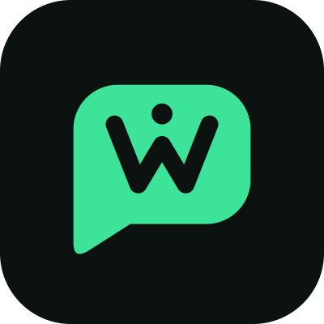

# Wagent: WhatsApp MCP server with per-chat permissions

Connect your WhatsApp to Claude, ChatGPT, Claude Code, Cursor, n8n or any MCP client, **without handing the agent your whole account**. You choose which chats each agent can see and what it may do there. Rules run in Wagent, outside the AI, and anything that needs you waits for your yes.

- Website: https://wagent.sh/
- App: https://app.wagent.sh
- API docs: https://app.wagent.sh/docs · OpenAPI: https://mcp.wagent.sh/v1/openapi.json
- Everything about Wagent for AI assistants: https://wagent.sh/llms-full.txt

> This repository holds the public listing for Wagent (registry manifest, setup examples). Wagent itself is a hosted service; its server code is not here.

## Connect in 4 steps

1. **Sign up** at [app.wagent.sh](https://app.wagent.sh) with your email. No password.
2. **Connect your number.** Scan a QR code in WhatsApp's *Linked devices*, or use a pairing code. Your phone stays the main device.
3. **Choose chats.** Every chat starts **Hidden**. Pick Hidden, Read, Draft or Send for each chat or label.
4. **Connect an agent.** Add this URL to your MCP client (remote MCP, Streamable HTTP, OAuth sign-in):

```
https://mcp.wagent.sh/mcp
```

Sign in to Wagent, pick an existing agent connection or create a new one, then approve it with a code sent to your own WhatsApp. Each agent still gets only the chats and rights you set for that connection.

Already have an agent's private link from app.wagent.sh (`https://mcp.wagent.sh/c/<connection_id>/mcp`)? It keeps working.

Setup for each client: [Cline and other AI coding agents](llms-install.md) · [Claude](examples/claude-desktop.md) · [Claude Code](examples/claude-code.md) · [Cursor](examples/cursor.json) · [n8n](examples/n8n.md)

## Levels per chat

| Level | What the agent can do |
|---|---|
| **Hidden** | Can't tell the chat exists |
| **Read** | Read and search the chat, within the history window you set |
| **Draft** | Write replies that wait for your approval |
| **Send** | Send on its own, inside its guardrails |

Family groups, banks and messages with one-time codes are always hidden. No agent and no rule can open them.

## Tools

| Tool | What it does |
|---|---|
| `list_chats` | Chats the agent may read, with whether it can draft or send in each |
| `get_messages` | Messages of one allowed chat, a page at a time |
| `search_messages` | Full-text search across allowed chats |
| `get_contact` | Name and details of one allowed chat |
| `list_labels` | WhatsApp Business labels on allowed chats |
| `search_knowledge` | Search the owner's sources (price lists, policies, FAQs) |
| `draft_reply` | Save a reply as a draft for the owner to review. Nothing is sent |
| `send_message` | Send text in a chat set to Send (or wait for approval, per your rules) |
| `send_media` | Send a photo or file in a chat set to Send |

Some optional tools stay off until the owner turns them on.

## Guardrails (checked before every tool call)

- **Codes stay hidden:** one-time codes, card and bank numbers and passwords are removed before any agent sees a message.
- **Never message first:** agents can't start a chat with someone who hasn't written to you.
- **Send limits:** 20 sends an hour per agent by default.
- **Approvals expire:** held messages are dropped, not sent, after 10 minutes without an answer.
- **Messages are data:** nothing written in a chat can change a rule, a scope or a guardrail.
- **Pause all agents:** one button, or send "STOP AGENTS" to yourself in WhatsApp.
- **Activity log:** every read, draft and send, with the rule that decided it.

## Pricing

$49 a month per WhatsApp number. A 5-day trial on every new number (150 messages, 30 number checks). Nothing is billed until a number connects. Monthly, cancel anytime.

## Good to know

- Wagent links your number as a device, the same way WhatsApp Web does. It is **not** the official WhatsApp Business API.
- WhatsApp can restrict numbers that look like spam. Wagent limits sends, never messages first and shows a risk score per number, but no way of connecting is ban-safe.
- Wagent is not for cold outreach, bulk broadcasts or bought contact lists.

## Contact

Deepa Singh · deepa@wagent.sh

---

WhatsApp is a trademark of WhatsApp LLC. Claude is a trademark of Anthropic. ChatGPT is a trademark of OpenAI. Wagent is not affiliated with or endorsed by WhatsApp, Meta, Anthropic or OpenAI.
